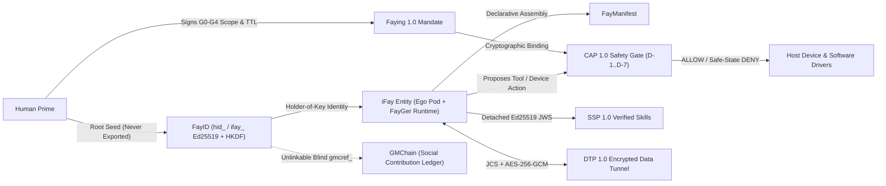

# iFay

[](https://github.com/ChainMode/iFay/actions/workflows/docs-ci.yml)
[](./LICENSE)
[](./package.json)
[](https://ifay.ai)


**Open cryptographic identity, capability mandates, and hardware/host safety gates for sovereign personal AI agents — plus `Ego`, a local personal model pod.**

**iFay** (*Individual Fay*) is a personal AI agent architecture bound cryptographically to a natural person (**Human Prime**), alongside **coFay** (*Common Fay*) for accountable organizational and public roles (`Fay = iFay + coFay`). Instead of giving an LLM unconstrained shell or API keys, a Human Prime derives Ed25519 subkeys (`FayID`), issues a scoped delegation envelope (`Faying` Mandate), runs personal weights locally (`Ego` + `FayGer` runtime), and enforces deterministic `ALLOW` / `DENY` capability checks (`CAP`) before any Host device or software actuation occurs.

---

## Architecture at a Glance



---

## Install FayGer Desktop & Server Engine (`v0.3.1`, Zero Toolchain Required)

Download the prebuilt zero-dependency `fayger` single binary (`faygerd` daemon + `fayger` CLI + offline **FayGer Dashboard** Web Console + `FHBP/1.0` Hardware Embodiment Hub) on **macOS** (Apple Silicon & Intel, plus `.dmg`), **Linux** (x86_64 & ARM64), or **Windows** (x86_64), then run `fayger doctor` to verify cold-start gates (and emit a zero-PII verification receipt), create an `iFay`, configure External LLMs & `Ego`, grant Host OS permissions, and supervise live execution:

```bash
# macOS & Linux (verifies SHA-256 checksum automatically)
curl -fsSL https://raw.githubusercontent.com/ChainMode/FayGer/main/scripts/install.sh | sh
~/.fayger/bin/fayger doctor
~/.fayger/bin/fayger up --open
```

```powershell
# Windows PowerShell (verifies SHA-256 checksum automatically)
irm https://raw.githubusercontent.com/ChainMode/FayGer/main/scripts/install.ps1 | iex
fayger doctor
fayger up --open
```

---

## 60-Second Developer SDK Quickstart

Requires **Node.js `>= 20.0.0`** and **npm**. Runs completely offline after install with zero external services, databases, or API keys:

```bash
git clone https://github.com/ChainMode/iFay.git && cd iFay && npm install && npm test && npm run demo
```

`npm run demo` (`ifay-demo`) executes a real sub-second cryptographic walkthrough:
1. Derives canonical RFC 4648 Base32 `Human Prime` (`hid_...`) and `iFay` (`ifay_...`) Ed25519 identities via HKDF-SHA256 and validates a `FayManifest` against [`faymanifest.schema.json`](./schema/faymanifest/faymanifest.schema.json).
2. Signs and verifies a `Faying 1.0` `G2` delegation Mandate from the Human Prime to the `iFay`.
3. Evaluates two concrete Host actions through the `Control Authority Protocol` (`CAP 1.0`) safety gate — **ALLOWING** an in-scope `inspect_git_workspace` read while deterministically **DENYING** an unauthorized `wipe_host_disk_partition` actuation (`E_GRADE_INSUFFICIENT` / code `2002`).
4. Verifies a progressive `L1 → L2 → L3` **iFACTS** conformance bundle (`ifacts-report/1.0`, `iFay Ready: Gold`).

---

## Digital Soul Packaging, Peer Sync & FayGer `.buf` Slicing (`@ifay/soul`)

An **iFay** runs inside **FayGer** as a portable **Digital Soul** (`Primary Body` + adaptive terminal `.buf` embodiment slices). Use [`packages/ifay-soul`](./packages/ifay-soul/README.md) (`ifay-soul`) to initialize a 6-dimension `iFay Profile` (stealth by default with opt-in platform registration and a single-active-`Ego` persona invariant), synchronize peer Primary Body replicas over an Ed25519-signed SHA-256 causal ledger, build `coFay` `RoleCharter 1.0` seats, and slice byte-exact `BUF\0` v1 binaries for workstation (`super`/`plus`), edge/drone (`lite`/`normal`), or `remote_only` (`thin`) `DeviceRuntimeProfile` targets:

```bash
# Run the full Primary Body peer-sync, 3-tier .buf slicing & coFay transfer walkthrough
npm run soul:demo

# Create a Digital Soul, sync a peer replica, and slice a FayGer-compatible .buf binary
node packages/ifay-soul/bin/ifay-soul.mjs init ./my-soul
node packages/ifay-soul/bin/ifay-soul.mjs sync ./my-soul ./my-soul-peer
node packages/ifay-soul/bin/ifay-soul.mjs slice ./my-soul --tier lite --out ./dist/my-ifay-lite.buf
node packages/ifay-soul/bin/ifay-soul.mjs inspect-buf ./dist/my-ifay-lite.buf
```

---

## MCP Server Quickstart (`@ifay/mcp-server`)

Connect Claude Desktop, Cursor, Windsurf, or any Model Context Protocol (`2024-11-05` / `2025-03-26`) client application directly to [`packages/mcp-server`](./packages/mcp-server/README.md) over `stdio`:

```json
{
  "mcpServers": {
    "ifay": {
      "command": "node",
      "args": ["/absolute/path/to/iFay/packages/mcp-server/dist/cli.js"]
    }
  }
}
```

| MCP Tool | Description |
|----------|-------------|
| `fayid_validate` | Validate canonical `ifay_`, `hid_`, `cofay_`, `org_`, `dyn_`, `grt_`, `vrf_`, and `gmcref_` identifiers, `did:fay:` URIs, and Ed25519 Holder-of-Key bindings |
| `faymanifest_validate` | Validate a `FayManifest` JSON payload and return auto-completed infrastructure modules, governed namespaces, and `Phase 1`–`Phase 5` classification |
| `cap_evaluate` | Gate AI agent tool/Host actuation requests against a signed `CAP 1.0` `DriverCapabilityManifest` + `Faying 1.0` Mandate (`ALLOW` / `DENY` with `D-1..D-7` rule & SHA-256 `auditTrace`) |
| `ssp_verify_descriptor` | Validate a Skill Sharing Protocol (`SSP 1.0`) descriptor and verify Detached Ed25519 JWS (`alg: "EdDSA"`) signatures |

---

## Workspace Packages & Schemas

This umbrella repository hosts the authoritative `FayManifest` schema alongside four publish-ready npm workspace packages (see [`PUBLISHING.md`](./PUBLISHING.md)):

| Package / Directory | Description |
|---------------------|-------------|
| [`packages/ifay-sdk`](./packages/ifay-sdk/README.md) (`@ifay/sdk`) | Zero-dependency SDK + `ifay-demo` CLI for `FayID` (RFC 4648 lowercase no-pad Base32 + HKDF-SHA256 subkeys + Ed25519 Holder-of-Key + RFC 8785 JCS), `Faying 1.0` Mandate envelopes, `FayManifest` builder/validator, `CAP 1.0` `D-1..D-7` safety gate, `SSP 1.0` Detached Ed25519 JWS `SkillProof`, `DTP 1.0` AES-256-GCM frames, and `Ego` two-tier Vault verification |
| [`packages/ifay-soul`](./packages/ifay-soul/README.md) (`@ifay/soul`) | Portable `iFay` Digital Soul & `coFay` `RoleCharter 1.0` seat packager, Ed25519 SHA-256 causal Primary Body peer sync ledger (`syncPrimaryReplicas`), adaptive `DeviceRuntimeProfile` embodiment slicer (`sliceSoulForDevice`), and `FayGer`-compatible `BUF\0` v1 canonical CBOR binary codec + `ifay-soul` CLI |
| [`packages/ifacts-harness`](./packages/ifacts-harness/README.md) (`@ifay/ifacts`) | Runnable **iFACTS** conformance suite enforcing the progressive `L1 → L2 → L3` gate (`blocked_by_previous_level`), explicit `coFay` / `coFACTS` scope separation, SHA-256 hash-chained E2E lifecycle verification, `iFay Ready` (`None` / `Bronze` / `Silver` / `Gold`) certification, and `ifacts-report/1.0` output |
| [`packages/mcp-server`](./packages/mcp-server/README.md) (`@ifay/mcp-server`) | Zero-dependency Model Context Protocol stdio server exposing `fayid_validate`, `faymanifest_validate`, `cap_evaluate`, and `ssp_verify_descriptor` |
| [`schema/faymanifest`](./schema/faymanifest/) | Authoritative JSON Schema ([`faymanifest.schema.json`](./schema/faymanifest/faymanifest.schema.json)) and validated reference fixtures for declarative iFay assembly |

```bash
# Run all workspace unit/integration tests (@ifay/sdk + @ifay/soul + @ifay/ifacts + @ifay/mcp-server + fixtures)
npm test

# Run the Digital Soul peer-sync & adaptive BuF slicing walkthrough
npm run soul:demo

# Run the progressive L1 -> L2 -> L3 iFACTS conformance self-test
npm run ifacts:self-test
```

---

## 13-Repository Ecosystem Status

The iFay System is organized as 13 focused public repositories under [`github.com/ChainMode`](https://github.com/ChainMode) (with full 9-locale documentation published at [ifay.ai](https://ifay.ai) and [Meritora](https://meritora-site.vercel.app)). For the authoritative cross-repository version, distribution, and real-vs-preview boundary matrix, see [`COMPATIBILITY.md`](./COMPATIBILITY.md). Below is the current, unvarnished engineering maturity of every repository:

| Repository | Role | Current Maturity Stage | Stack & Verified Tests |
|------------|------|------------------------|------------------------|
| [`ChainMode/iFay`](https://github.com/ChainMode/iFay) | Umbrella Blueprint, `FayManifest`, `@ifay/sdk`, `@ifay/soul`, `@ifay/ifacts`, `@ifay/mcp-server` (`v0.3.0`) | Spec + Tested Reference SDK, Soul Packager, Conformance Suite & MCP Server | Node.js / TS ESM · `60` tests + `2` schema fixtures |
| [`ChainMode/FayID`](https://github.com/ChainMode/FayID) | Self-Sovereign Cryptographic Identity (`hid_` / `ifay_` / `cofay_` / `org_`) (`v1.1.0`) | Frozen `1.0` Spec + Tested Reference Toolkit & `Auth Exchange` Proxy | Node.js ESM · `30` unit tests + `27` vectors |
| [`ChainMode/Faying-Protocol`](https://github.com/ChainMode/Faying-Protocol) | Human Prime ↔ Fay Delegation Handshake & `G0`–`G4` Mandates (`v1.2.0`) | Frozen `1.0` + `1.1-cofay` Spec + `Rogue Fay` Guardian Middleware | TS / Rust / Python · `39+` tests + `10+` vectors |
| [`ChainMode/FayGer`](https://github.com/ChainMode/FayGer) | Three-in-One Desktop/Server Runtime (`faygerd` + CLI + Dashboard), Brain Config, OS Drivers & `FHBP/1.0` Hub (`v0.3.1`) | Prebuilt 5-Target Binaries, macOS `.dmg`, Android `.apk`, C99 Firmware SDK & Tested Runtime | Rust (11 crates) + ISO C99 · `659+` tests |
| [`ChainMode/Ego`](https://github.com/ChainMode/Ego) | Local Personal Model Pod, Multi-Edition LoRA Dojo, `Ego School` & Signed Vault (`v0.3.0`) | Spec + Tested Local Training, Loopback Service & Packaging Pipeline | Python / MLX / PEFT · `805` pytest tests |
| [`ChainMode/Control-Authority-Protocol`](https://github.com/ChainMode/Control-Authority-Protocol) | Hardware & Host Actuation Safety Gate (`CAP 1.0`, `D-1..D-7`) (`v1.0.0`) | Frozen `1.0` Spec + Dual Reference Engines | TypeScript & Rust · `81` TS tests + `14` vectors |
| [`ChainMode/Data-Tunnel-Protocol`](https://github.com/ChainMode/Data-Tunnel-Protocol) | Encrypted Host-to-Fay Telemetry & Minimal-Injection Collector (`DTP 1.0`, `v1.1.0`) | Frozen `1.0` Spec + Dual Reference Codecs & `dtp-collector` | TypeScript & Rust · `316` TS + `9` Rust tests |
| [`ChainMode/Skill-Sharing-Protocol`](https://github.com/ChainMode/Skill-Sharing-Protocol) | Signed Skill Discovery & Detached Ed25519 JWS Proofs (`SSP 1.0`, `v1.1.0`) | Frozen `1.0` Spec + Tested `ssp-publisher` / `ssp-radar` | TypeScript · `97` unit/property tests + `18` vectors |
| [`ChainMode/Telepathy-Protocol`](https://github.com/ChainMode/Telepathy-Protocol) | Structured Shared-Context Negotiation & A2A/MCP Bridges (`TP 1.0`, `v1.1.0`) | Frozen `1.0` Explicit-Schema MVP (Latent-vector track experimental) | Node.js ESM · `50` tests + `21` vectors |
| [`ChainMode/Interactive-Conversation-Protocol`](https://github.com/ChainMode/Interactive-Conversation-Protocol) | Multimodal `.ctx` Conversation Envelopes & Adaptive Endpoints (`ICP 1.0`, `v1.1.0`) | Frozen `1.0` Spec + Tested Reference Parser & Multi-Device Renderer | TypeScript · `65` tests + `20` vectors |
| [`ChainMode/Global-Merit-Chain`](https://github.com/ChainMode/Global-Merit-Chain) | Non-Speculative Social Contribution Ledger & 2-Phase BFT Node (`v0.3.0`) | Spec + Local 4-Node BFT Devnet (`gmc-node`), Priority Consumption & `Meritora` | Rust · `657` workspace tests (0 tx fee / 0 block reward) |
| [`ChainMode/coFay`](https://github.com/ChainMode/coFay) | Public/Organizational Role Avatars, `RoleCharter 1.0` & `coFACTS` (`v1.1.0`) | 9-Locale Blueprint + Tested Role Wizard, Steward Transfer & `.buf` Packer | Node.js ESM · `15` tests + `20` vectors |
| [`ChainMode/MeriToken`](https://github.com/ChainMode/MeriToken) | Non-Monetary Social Contribution Unit (`μ` / Merit Unit) (`v0.2.0`) | 9-Locale Blueprint Charter (Accounting enforced in `Global-Merit-Chain`) | Specification & Governance Charter |

---

## Engineering & Governance Transparency

iFay is built through **Human Prime architectural governance** — human-authored vision, security invariants (`D-1..D-7`), cryptographic ownership decisions, and specification freezes — paired with **AI-agent-assisted multi-repository implementation**. Every change across the 13 repositories is gated by deterministic cryptographic test vectors, JSON Schema / CDDL validation, secret scanning, 9-locale structural/link parity checks (`docs-ci.yml`), and canonical terminology enforcement before landing on `main`.

---

## Documentation & Blueprint Index

### Tutorials & Engineering Guides
- **Tutorials**:
  - [Build and Verify a Local iFay Client Node in 15 Minutes](./docs/en/tutorials/building-a-client-node.md) ([中文](./docs/zh-CN/tutorials/building-a-client-node.md))
  - [Bridging MCP and LLM Tools Safely into the iFay Protocol Stack](./docs/en/tutorials/building-mcp-with-llms.md) ([中文](./docs/zh-CN/tutorials/building-mcp-with-llms.md))
- **Roadmap & Specification Governance**:
  - [Ecosystem Roadmap and Engineering Milestones](./docs/en/development/roadmap.md) ([中文](./docs/zh-CN/development/roadmap.md))
  - [Versioning and Edition Freeze Discipline (`MAJOR.MINOR`)](./docs/en/specification/versioning.md) ([中文](./docs/zh-CN/specification/versioning.md))

### Blueprint Reference ([Full Table of Contents](./docs/en/blueprint/Table-of-Contents.md) · [ifay.ai](https://ifay.ai))
- **Overview & Foundations**
  - [Overview, Vision & Framework](./docs/en/blueprint/01-Overview.md)
  - [Vocabulary: Definition & Concept](./docs/en/blueprint/02-Definition-and-Concept.md)
  - [Design Principles](./docs/en/blueprint/03-Design-Principles.md)
  - [Roadmap: 5 Phases](./docs/en/blueprint/04-Roadmap.md) (Phase 1 Simulated Operations → Phase 2 Direct Client Takeover → Phase 3 Virtual World Interface → Phase 4 `iFay + coFay` Personification → Phase 5 Social Value Collaboration)
  - [iFay Personality Instantiation](./docs/en/blueprint/06-iFay-Personality-Replication.md) & [iFay Profile](./docs/en/blueprint/07-iFay-Profile.md)
- **iFay Entity Four-Layer Architecture**
  - **Social Layer**: [FayID, Credentials Management & GMChain](./docs/en/blueprint/08-Social-Layer.md) · [Guardianship](./docs/en/blueprint/15-Guardianship.md)
  - **Interaction Layer**: [Perception (First-person Tracer, Sensor, Self-awareness)](./docs/en/blueprint/09-Interaction-Layer-Perception.md) · [Action (Simulated Operation, Invoke Skill, Self-driven Behavior)](./docs/en/blueprint/10-Interaction-Layer-Action.md)
  - **Cognition Layer**: [Thinking (Personal Data Heap, External Knowledge, Aligned Consciousness)](./docs/en/blueprint/11-Cognition-Layer-Thinking.md) · [Skills (Device Driver Hub, Registered Skill, Internal Skill)](./docs/en/blueprint/12-Cognition-Layer-Skills.md)
  - **Ego Layer**: [`Ego` Personal Model Pod](https://github.com/ChainMode/Ego)
- **Assembly, Conformance & Core Protocols**
  - [Declarative Assembly (`FayManifest`)](./docs/en/blueprint/13-FayManifest.md) & [Architecture Conformance (`iFACTS`)](./docs/en/blueprint/14-iFACTS.md)
  - [Faying Protocol](https://github.com/ChainMode/Faying-Protocol) · [Interactive Conversation Protocol](https://github.com/ChainMode/Interactive-Conversation-Protocol) · [Telepathy Protocol](https://github.com/ChainMode/Telepathy-Protocol) · [Control Authority Protocol](https://github.com/ChainMode/Control-Authority-Protocol) · [Data Tunnel Protocol](https://github.com/ChainMode/Data-Tunnel-Protocol) · [Skill Sharing Protocol](https://github.com/ChainMode/Skill-Sharing-Protocol)
- **Application Scenarios**
  - [iFay Application Scenarios](./docs/en/blueprint/05-Application-Scenarios.md) (Obtaining an iFay, Faying handshake, UI operation, and CAP-governed Host device/software control)

---

## Contributing

We welcome contributions in all forms! Whether you are fixing bugs, adding conformance vectors, improving documentation, or proposing protocol extensions, please review our [Contribution Guide](./CONTRIBUTING.md), [Publishing Guide](./PUBLISHING.md), [Security Policy](./SECURITY.md), and [Code of Conduct](./CODE_OF_CONDUCT.md).

---

## Vision & Basic Principles

### Social Values
1. Take over mechanical, repetitive, dangerous labor and tedious auxiliary work for the Human Prime.
2. Improve the Human Prime's safety, health, and quality of life.
3. Amplify the Human Prime's social contribution and corresponding recognition.

### Basic Principles
1. Comply with social ethics and public order.
2. Align deeply with the Human Prime (values, preferences, skills, permissions, responsibilities, habits, and style), subject to Article 1.
3. Under Articles 1 and 2, inhabit and operate authorized Host hardware and software, act within delegated bounds, and protect the Human Prime's rights.
4. Communicate clearly and efficiently with humans (including the Human Prime) while minimizing unnecessary friction.
5. Interoperate with peer Fays via structured protocols (such as the Telepathy Protocol) with explicit consent and auditability.

---

## License

This repository uses a dual-track open-source license (`Copyright (c) 2025-2026 ChainMode contributors`):

- **Code, Schemas, Fixtures & Workspace Packages** (`packages/`, `schema/`, `releases/`): Licensed under the **MIT License** — see [LICENSE](./LICENSE).
- **Specifications, Blueprints & Tutorials** (`docs/`): Licensed under **Creative Commons Attribution 4.0 International (CC BY 4.0)** — see [LICENSE-DOCS](./LICENSE-DOCS).
